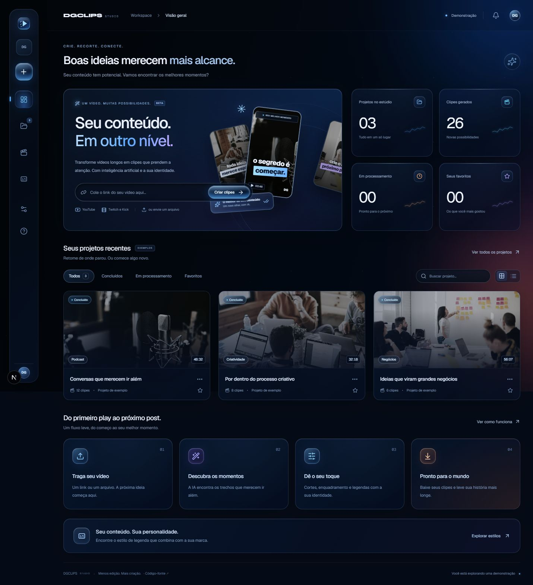

# DGCLIPS Studio

**Menos edição. Mais criação.** Um estúdio pessoal para transformar vídeos longos em clipes, com uma interface nova em português, tema escuro e identidade verde-lima.



Adaptação do [SupoClip](https://github.com/FujiwaraChoki/supoclip). O motor original de transcrição, seleção de trechos, legendagem, reenquadramento e edição foi preservado. Licença AGPL-3.0 em [LICENSE](LICENSE); procedência em [NOTICE.md](NOTICE.md).

## O que está incluído

- Visão geral com importação de vídeo e estatísticas dos projetos.
- Biblioteca com busca sem distinção de acentos, filtros, ordenação e visualização em grade ou lista.
- Favoritos salvos neste navegador, separados por usuário.
- Galeria de estilos de legenda com seleção persistente para novos projetos.
- Criação por link do YouTube, Twitch e Kick, ou upload com arrastar e soltar.
- Duração, formato e legendas configuráveis antes de processar.
- Login e projetos privados; editor e processamento do projeto original.
- Demonstração identificada com três projetos ilustrativos e duas prévias de vídeo reais do upstream.
- Configuração Vercel, Docker de produção, exemplos de variáveis e testes.

Os números e imagens da demonstração são exemplos. Nenhum vídeo enviado é processado no modo demonstração. As imagens da biblioteca ilustram categorias; não são capas dos vídeos demonstrativos. O modo real começa com a biblioteca da conta, sem projetos fictícios.

## Experimentar a interface

Use Node.js 22 ou 24 e pnpm 10.27.0:

```bash
cd frontend
corepack enable
pnpm install --frozen-lockfile
pnpm dev
```

Abra **http://localhost:3107**. Sem configuração de produção, o estúdio abre em demonstração. Você também pode copiar `frontend/.env.example` para `frontend/.env.local` e manter `DGCLIPS_DEMO=true`.

## Colocar no GitHub

O pacote ZIP contém os arquivos de código, sem histórico Git, dependências, builds ou segredos. Extraia-o e crie um repositório vazio na sua conta. Dentro da pasta extraída:

```bash
git init
git add .
git commit -m "feat: launch DGCLIPS Studio"
git branch -M main
git remote add origin https://github.com/dgvfx2026/dgclips.git
git push -u origin main
```

Se estiver usando o checkout local entregue junto do ZIP, ele conserva a origem e o histórico do SupoClip para rastreabilidade. Nesse caso, renomeie o remoto antes de adicionar o seu: `git remote rename origin upstream`.

## Publicar na Vercel

1. Importe [dgvfx2026/dgclips](https://github.com/dgvfx2026/dgclips) na Vercel.
2. Use a raiz do repositório (**Root Directory: .**). O arquivo **vercel.json da raiz** define os serviços e as rotas.
3. A interface é pública; backend e MCP ficam internos. As rotas /api continuam no Next.js para preservar o login.
4. Os bindings frontend → backend e mcp → backend são injetados automaticamente pela Vercel. Não preencha essas URLs manualmente.
5. Comece com DGCLIPS_DEMO=true e NEXT_PUBLIC_SELF_HOST=true. Sem serviços externos, a interface abre em demonstração e o worker aguarda configuração.
6. Para processar vídeos, configure PostgreSQL, Redis TLS, S3 e chaves de IA conforme [o guia de publicação](docs/DGCLIPS_DEPLOY.md). Depois mude DGCLIPS_DEMO=false e faça novo deploy.

O worker é um daemon de 2 GiB com uma instância em iad1. Os serviços em contêiner e os daemons usam recursos e cotas da Vercel. [Serviços](https://vercel.com/docs/services) · [Daemons e limites](https://vercel.com/docs/daemons/limits).

## Rodar tudo no seu computador

O `docker-compose.yml` original continua disponível. Copie o `.env.example` da raiz para `.env`, preencha as chaves de transcrição/IA e os segredos, e rode:

```bash
docker compose up -d --build
```

A configuração completa local do upstream está em [docs/setup.md](docs/setup.md). Para a arquitetura com Vercel, use **`docker-compose.production.yml`**, que não inicia um segundo frontend. Essa é a alternativa com servidor próprio, documentada em docs/DGCLIPS_DOCKER_DEPLOY.md.

## Verificar

```bash
cd frontend
pnpm lint
pnpm typecheck
pnpm test
pnpm build
pnpm exec playwright install chromium
pnpm test:studio
pnpm check:deploy
```

`check:deploy` valida as variáveis sem exibir seus valores. O modo de produção exige seus próprios serviços e chaves; as configurações Docker e as chamadas reais de IA precisam ser validadas no servidor de destino. Publicação e criação de contas em serviços externos não são feitas automaticamente.

## Organização

| Pasta | Conteúdo |
| --- | --- |
| `frontend/` | Aplicação Next.js pronta para importar na Vercel |
| `frontend/src/components/dgclips/` | Interface do novo estúdio |
| `backend/` | API, worker e motor de vídeo do SupoClip |
| `deploy/` | Variáveis de produção, HTTPS e CORS do armazenamento |
| `docs/DGCLIPS_DEPLOY.md` | Passo a passo para ativar o processamento real |
| `docs/UPSTREAM_README.md` | README original preservado |

As páginas editoriais, integrações sociais e recursos avançados do upstream continuam no código. O fluxo principal do DGCLIPS está em `/`, `/projects`, `/clips`, `/templates`, `/guide` e `/workspace/settings`. A conta fica em `/settings`, o resultado em `/tasks/:id` e o editor em `/tasks/:id/edit`.
