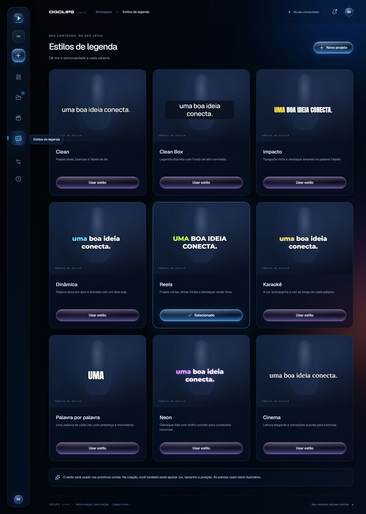

# DGCLIPS Studio 1.2 para Windows

A mesma interface Midnight / Liquid Glass, com processamento no computador. Não precisa instalar Docker, WSL, Python, Node, banco de dados, Redis ou Ollama. Não exige cadastro nem chaves de API.



## Para usar

1. Abra **DGCLIPS-Instalar-1.2.exe** e escolha a pasta. O instalador sugere `D:\DGCLIPS Studio` quando disponível. Para atualizar, feche o aplicativo e escolha a pasta da instalação existente; preserve `DGCLIPS-Dados`.
2. Abra **DGCLIPS Studio** pelo atalho, cole um link ou escolha um arquivo.
3. Escolha a quantidade, o foco, a duração, a composição e a legenda. Confirme a geração.
4. Acompanhe o progresso, assista aos cortes e use **Salvar clipe**.

A primeira análise baixa automaticamente a IA editorial, cerca de **2,5 GB**, com progresso na tela. O download fica em `DGCLIPS-Dados/Modelos`. O modelo de transcrição Whisper large-v3-turbo e os componentes de vídeo já acompanham o instalador. Depois desse primeiro download, vídeos locais podem ser processados sem internet.

Links exigem internet. O próprio site pode bloquear vídeos privados, restritos, indisponíveis ou que exigem login; nesse caso, use um arquivo local. O Windows precisa do Microsoft Edge WebView2, já presente na máquina avaliada.

## Curadoria e quantidade

- De **1 a 50 clipes**, ou quantidade automática proporcional à duração, limitada a 30.
- Foco em melhores momentos, humor, falas importantes ou histórias completas; preferência adicional em texto.
- Durações de 15–30, 30–60, 60–90 segundos ou automática de 8–90 segundos.
- Uma IA local lê janelas sobrepostas da transcrição, propõe trechos, compara candidatos e revisa contexto e desfecho. Frases de início e fim, duração, notas e uma frase de evidência são validados. Cortes sobrepostos ou repetidos são removidos.
- Cada clipe apresenta o motivo da seleção. A ordenação pode seguir a preferência editorial ou a linha do tempo.
- A quantidade solicitada é um máximo. Se a revisão encontrar menos bons candidatos, o resultado explica a diferença. Não existe preenchimento silencioso com momentos aleatórios.

A seleção analisa a **fala transcrita**. Ainda não interpreta piadas puramente visuais, música, lances sem narração ou expressões faciais. A transcrição pode errar palavras e nomes, especialmente em jogos com vozes sobrepostas. Revise os resultados; as notas não preveem visualizações nem garantem viralização.

## Legendas e enquadramento

**9 estilos:** Clean, Clean Box, Impacto, Dinâmica, Reels, Karaokê, Palavra por palavra, Neon e Cinema. Os estilos dinâmicos usam os tempos de cada palavra; cor, tamanho e posição podem ser ajustados. A galeria usa texto ilustrativo, e as exportações usam a fala real.

**Tela cheia vertical**, **câmera em cima**, **câmera embaixo**, imagem completa com fundo desfocado e formato original. Exportação vertical em 1080 × 1920 ou 720 × 1280, sem esticar a imagem. Nos layouts de react, os dois painéis preenchem seus espaços; parte das bordas da origem pode ser recortada.

Prepare a prévia, use a sugestão de câmera e ajuste as áreas da câmera e do conteúdo arrastando na imagem ou pelos campos em porcentagem. A sugestão detecta rostos em um quadro; o enquadramento é fixo durante o vídeo e **não acompanha automaticamente o falante**. Vídeos já importados podem ser reutilizados, incluindo a transcrição quando disponível.

## Dados e desempenho

- Projetos, fontes, modelos e clipes ficam em `DGCLIPS-Dados`, ao lado do aplicativo. A desinstalação preserva essa pasta.
- Nenhum vídeo ou transcrição é enviado a serviços de IA. A conexão externa serve para baixar links e o modelo editorial.
- Até 8 GB por vídeo, quatro horas de duração e cinco vídeos na fila; um processamento por vez.
- A transcrição usa Whisper large-v3-turbo na CPU/int8 e substitui automaticamente caches de transcrição de modelos anteriores. A análise editorial usa Vulkan quando disponível e tenta CPU se a GPU não puder carregar o modelo. A exportação usa FFmpeg/libx264 na CPU.
- A máquina avaliada tem Ryzen 7 5700X, 32 GB de RAM e RTX 4060 de 8 GB. Máquinas com menos memória podem ser mais lentas ou não comportar a análise. O aplicativo verifica espaço em disco antes dos downloads.
- Fechar o programa interrompe o processamento. Na próxima abertura, o projeto permite tentar novamente.
- A edição web na Vercel continua separada; instalar esta edição não ativa processamento no site.

## Construir a partir do código

Windows x64, Python 3.12, Node 24, pnpm 10.27 e NSIS 3.13 da distribuição oficial. O usuário final não precisa desses programas.

```powershell
py -3.12 -m venv .desktop-env
.\.desktop-env\Scripts\python.exe -m pip install -r desktop/requirements-lock.txt
pnpm --dir frontend install --frozen-lockfile
node desktop/prepare-assets.mjs
.\.desktop-env\Scripts\python.exe desktop/prepare-editorial.py
node desktop/build-ui.mjs
.\.desktop-env\Scripts\python.exe desktop/prepare-build.py
.\.desktop-env\Scripts\python.exe -m unittest discover -s desktop -p "test_*.py"
.\.desktop-env\Scripts\python.exe -m PyInstaller --noconfirm --workpath desktop/build --distpath desktop/dist desktop/DGCLIPS-folder.spec
```

Modelos e runtime são fixados por commit/versão e SHA-256 nos manifests; os downloads são verificados. `prepare-editorial.py --with-model` também guarda o modelo editorial para desenvolvimento. **Esse modelo de 2,5 GB não entra no instalador**: o spec inclui explicitamente apenas os modelos de voz e detecção de rostos.

A interface importa os componentes reais do frontend com adaptadores locais. Para compilar apenas a interface, sem baixar modelos: `node desktop/prepare-assets.mjs --ui-only` e `node desktop/build-ui.mjs`.

Gere o instalador com `makensis.exe /INPUTCHARSET UTF8 /DPAYLOAD="<pasta absoluta desktop/dist/DGCLIPS>" /DOUTPUT="<arquivo absoluto DGCLIPS-Instalar-1.2.exe>" desktop/installer.nsi`. Use uma pasta exclusiva de build; nunca a pasta do código ou uma instalação com dados.

Diagnóstico do aplicativo compilado:

```powershell
desktop/dist/DGCLIPS/DGCLIPS.exe --self-check desktop/dist/check.json --test-editorial --test-video frontend/public/clips/podcast-1.mp4
```

O teste editorial exercita o runtime privado com resposta estruturada. O teste de vídeo verifica transcrição e exportação com seleção mecânica explícita de diagnóstico. A curadoria semântica deve ser testada separadamente com um vídeo completo, verificando contexto, motivos e cortes reais. Confirme `ok: true`, `editorial_test.ok: true` e `video_test.status: completed`; teste também a janela nativa e o diálogo de salvar.

Modelos, dependências, vídeos e resultados de build não entram no Git. Licenças de bibliotecas acompanham o instalador em `_internal/licenses`; fontes e avisos de terceiros também estão neste diretório de código. Projeto AGPL-3.0, preservando a atribuição ao SupoClip. O instalador não possui assinatura digital.
